# P2P Communication and File Sharing

## Project description

This Python application allows peers to exchange text messages and ordinary files directly over TCP. Each peer can accept incoming connections and connect to other peers. There is no central server. The Tkinter GUI provides peer configuration, a connected peer list, text messaging, a file picker, an event log and transfer progress.

## Requirements

- Python 3.9 or later with working Tkinter.
- No third-party Python packages are required.
- For multiple computers: a shared LAN or Wi-Fi network that allows communication between devices.

## Setup and run

1. Extract the ZIP and open the project folder in VS Code.
2. Open a terminal in the folder containing main.py.
3. Check Tkinter with `python -m tkinter`, then close the test window.
4. Run:

```text
python main.py
```

On Windows, use `py` instead of `python` if that is how Python is installed. On systems where the command is `python3`, use that command instead.

## Test on one computer

Open a separate terminal and application instance for each peer:

| Peer | Listening port |
|---|---|
| Alice | 5000 |
| Bob | 5001 |
| Saima | 5002 |

1. Enter each peer's name and listening port. Optionally choose a separate receive folder for each instance before starting.
2. Click **Start Peer** in each window.
3. In Bob's window, enter remote IPv4 `127.0.0.1` and remote port `5000`, then click **Connect**.
4. In Saima's window, connect to `127.0.0.1:5000`, then to `127.0.0.1:5001`.
5. Each peer should list the other two. One connection between a pair supports communication in both directions.

Different instances on the same computer must use different listening ports. The address `127.0.0.1` refers to the current computer.

## Connect two computers

1. Copy the project to both computers and run it on each.
2. Connect both computers to the same LAN or Wi-Fi.
3. On PC A, run `ipconfig` on Windows and find the IPv4 address of its active Wi-Fi or Ethernet adapter.
4. Start Alice on PC A with listening port `5000`.
5. Start Bob on PC B with listening port `5001`.
6. In Bob's window, enter PC A's actual IPv4 address and remote port `5000`, then click **Connect**.
7. If network access is blocked on a lab PC, ask the lab administrator to allow the application according to lab policy.

Use the destination computer's actual address, not `127.0.0.1` or `0.0.0.0`, when connecting to another computer.

## Send text and files

1. Select the recipient in the connected peer list.
2. Enter a message and click **Send Text**, or press Enter.
3. To send a file, click **Choose File & Send**, select a file, and click **Open**.
4. Wait for the receiver's successful receipt message and the sender's receipt confirmation.
5. Click **Open received files** on the receiver to inspect the saved file.

Text files, images, audio, video, PDFs, ZIPs and other ordinary files all use the same binary transfer mechanism. No code changes are needed for different file types. Received files are saved in `downloads` by default or in the folder chosen before starting. Existing filenames are preserved by giving duplicate downloads a numbered name.

Messages and files go to one selected, directly connected peer. Peers do not relay messages or discover other peers automatically. Click **Stop** or close the window to disconnect.

## Project structure

```text
P2P_Assignment_199/
|-- main.py
|-- p2p_node.py
|-- protocol.py
|-- README.md
|-- requirements.txt
|-- downloads/
`-- screenshots/
```

- `main.py`: Tkinter GUI, button actions and display of queued network events.
- `p2p_node.py`: listener, outgoing connections, handshake, connection threads and transfers.
- `protocol.py`: length-prefixed JSON messages and exact-length socket reads.
- `downloads/`: received files; initially empty.
- `screenshots/`: location for demonstration screenshots.

## Communication protocol

1. Peers exchange `hello` and `hello_ack` messages containing their IDs, names and listening ports.
2. Each JSON message is framed as `[4-byte length][UTF-8 JSON payload]`. The length uses network byte order.
3. A text message contains its type and message string.
4. A file message declares its name, byte size and transfer ID, followed by exactly that many raw bytes.
5. Files are streamed in chunks of up to 64 KiB, rather than loaded entirely into memory.
6. A `file_end` frame carries a SHA-256 digest. The receiver checks the digest before completing the saved file and sends a `file_ack` receipt.

TCP is a byte stream, so `recv_exact` loops until the required number of bytes has arrived. Each connection has a sending lock to prevent messages from being inserted into a file body. Background threads handle network work; the GUI reads their event queue on its main thread.

## Error handling and limitations

The application handles invalid addresses and ports, unavailable peers, missing files, missing peer selections and disconnected peers. Interrupted incoming transfers are cleaned up when an error is detected. A forced process exit can leave a `.part` file. Transfers do not resume automatically.

This is an educational LAN application. Traffic is not encrypted and peer names are not authenticated. SHA-256 verifies transferred content; it does not prove a sender's identity. Available disk space and filesystem limits apply. Do not edit a source file while it is being sent.
## Demonstration checklist

- Start peers and show their names and listening ports.
- Connect two peers and exchange text in both directions.
- Send an image and a real audio or video file, then open them on the receiver.
- Connect a third peer and exchange messages and files between different pairs.
- Demonstrate on separate LAN computers where available.

## Example screenshots

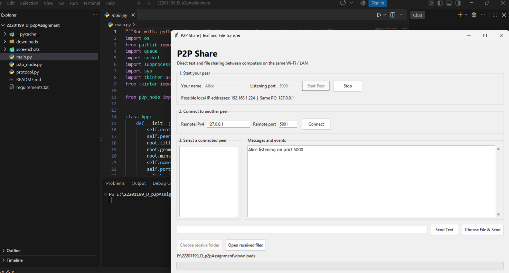

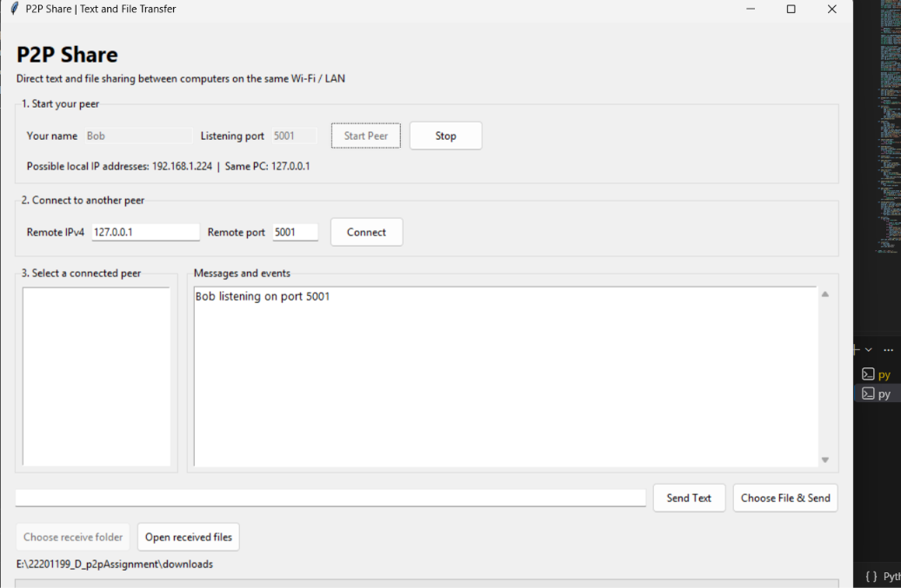

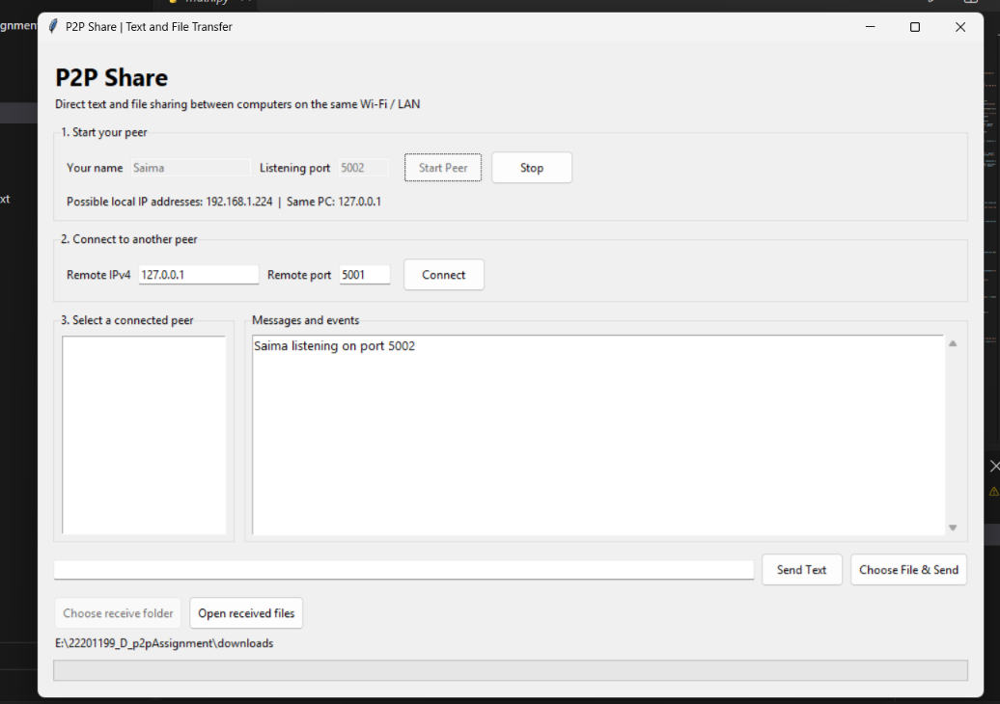

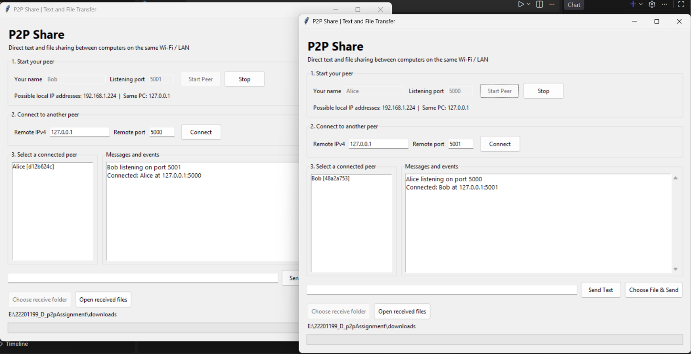

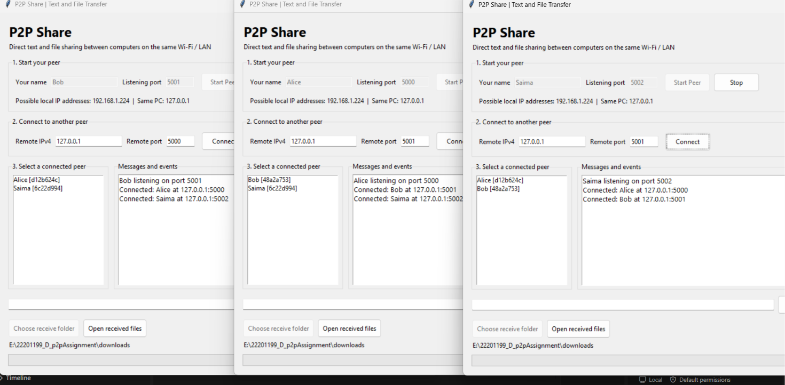

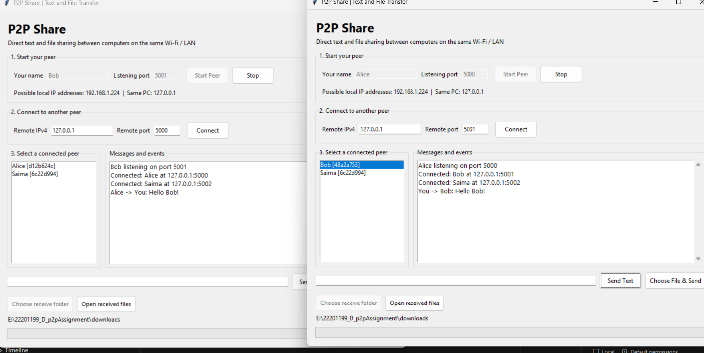

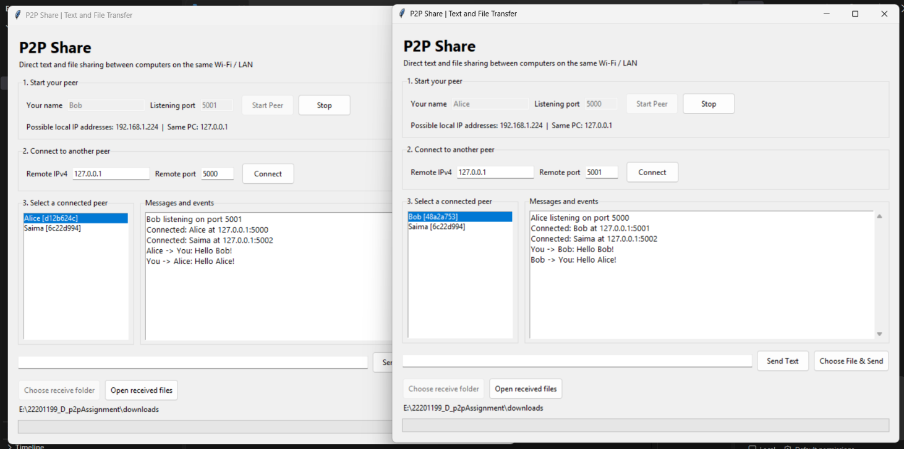

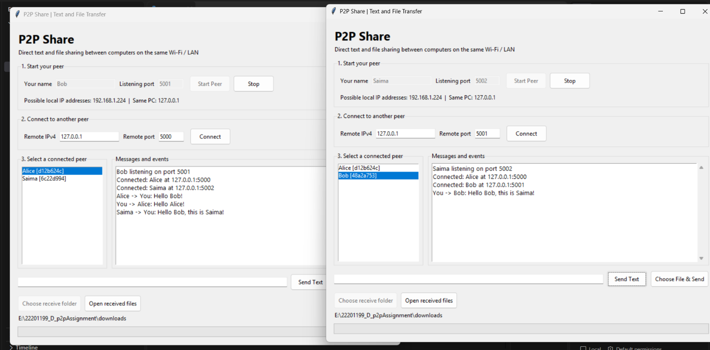

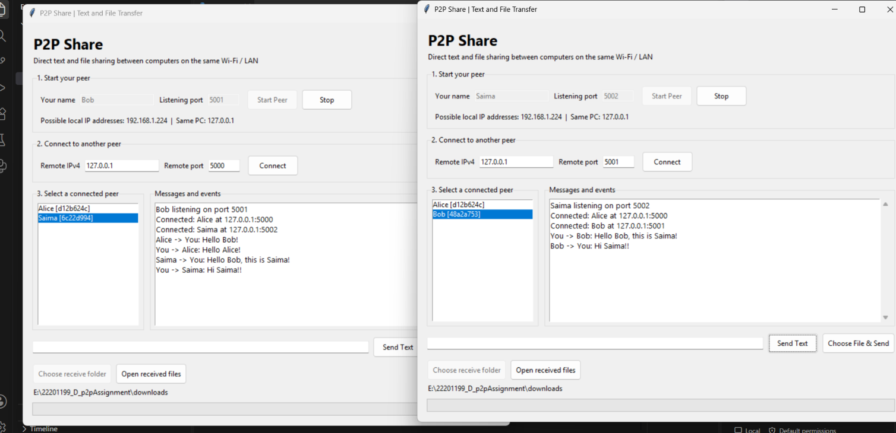

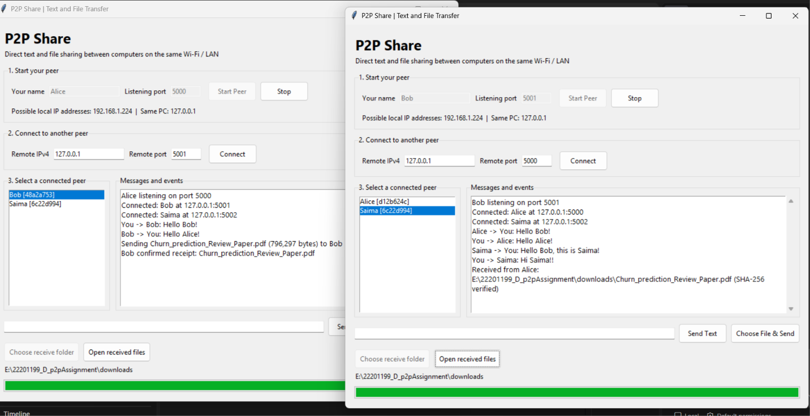

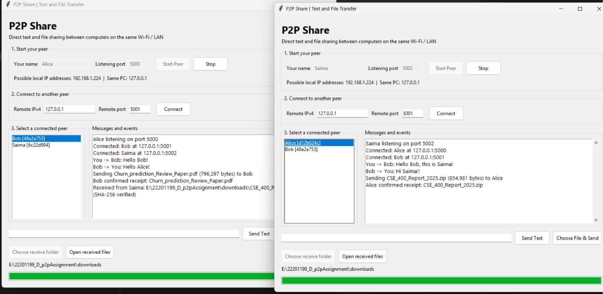

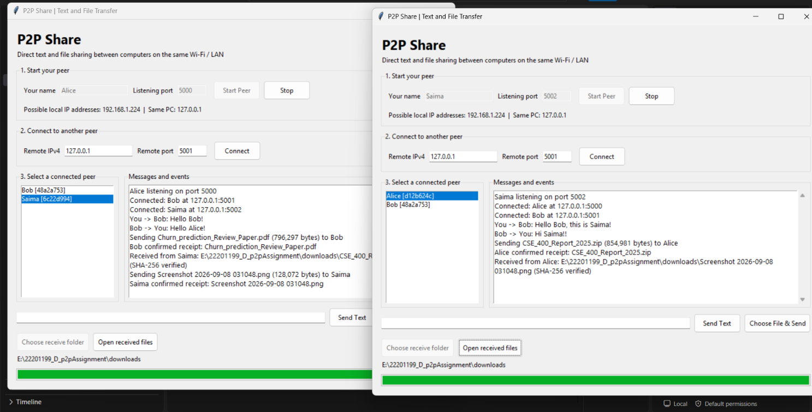

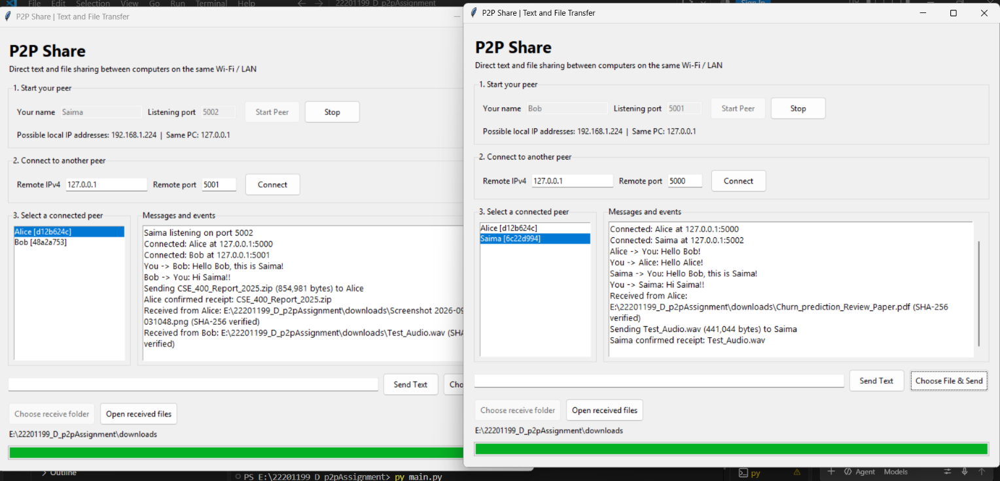

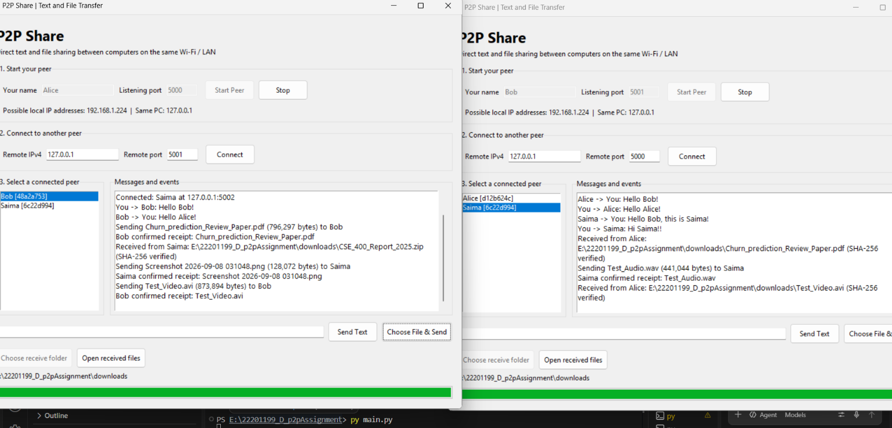

